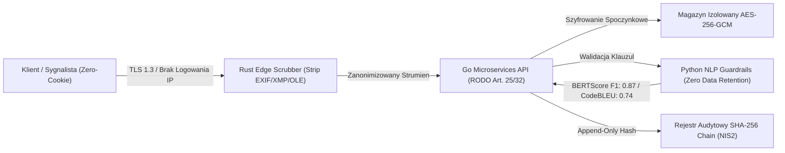
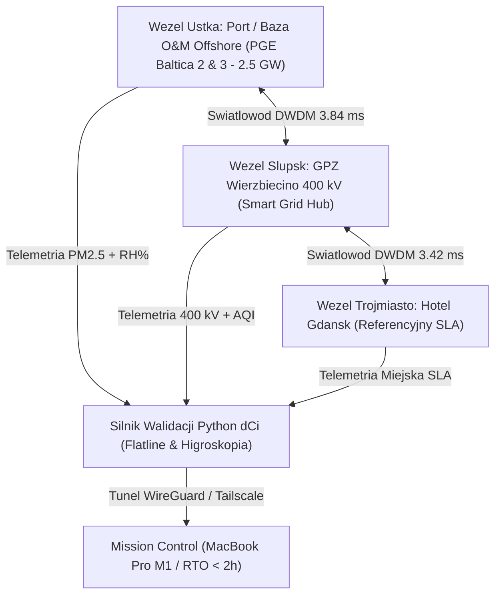
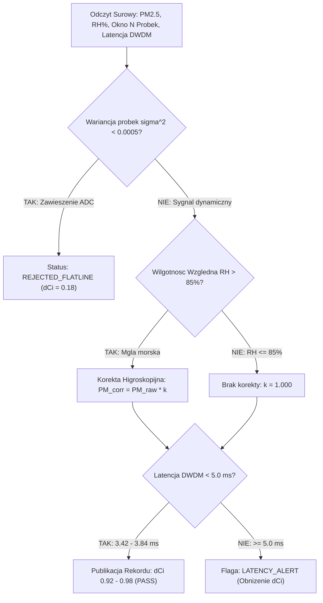
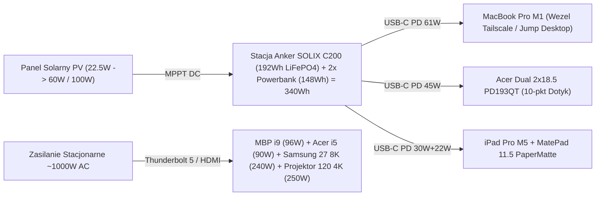

# Folder 1: Diagramy dla Ekspertow (Architekci Oprogramowania, SecOps / Bezpieczenstwo Sieci, Specjalisci Smart Grid)

Katalog zawiera techniczne diagramy architektoniczne, sieciowe i pomiarowe projektu:

1. **EXP-01: Architektura C4 & Zero-Trust Edge (Rust Scrubber + Go API + Python RAG + SHA-256)**
2. **EXP-02: Topologia Optyczna DWDM (< 5 ms) & Korytarz Smart Grid (Ustka 2.5 GW — Slupsk 400 kV — Trojmiasto)**
3. **EXP-03: Algorytm Walidacji Sygnalu AQI / dCi (Detekcja Flatline Faults & Korekta Higroskopijna RH > 85%)**
4. **EXP-04: Schemat Zasilania i Szyny Danych Biurka Anti-Gravity (1000W Stacjonarnie / 340Wh Off-Grid 13.7h)**

---

## EXP-01: Architektura C4 & Zero-Trust Edge

---

## EXP-02: Topologia Optyczna DWDM (< 5 ms) & Korytarz Smart Grid 400 kV

---

## EXP-03: Algorytm Walidacji Sygnalu AQI / dCi

---

## EXP-04: Schemat Zasilania i Szyny Danych Biurka Anti-Gravity

