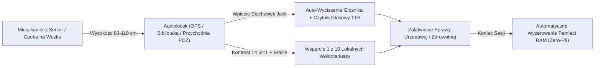
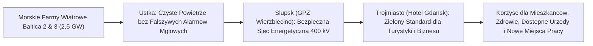
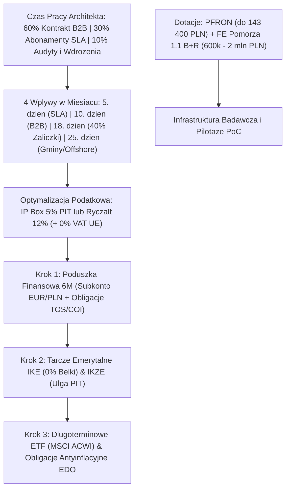
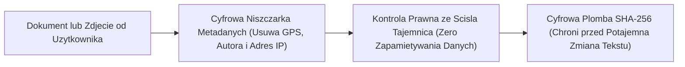

# Folder 2: Diagramy dla Przegladajacych, Komentujacych i Odbiorcow Oprogramowania

Katalog zawiera przystepne diagramy procesowe, spoleczne i finansowe przeznaczone dla samorzadow, recenzentow, obywateli, seniorow oraz inwestorow:

1. **PUB-01: Sciezka Obywatela i Seniora w Pilotazu "Dostepna Gmina — Cyfrowa Samopomoc" (3 Audiokioski + 10 Wolontariuszy)**
2. **PUB-02: Mapa Korzysci Spolecznych i Ekologicznych: Ustka — Slupsk — Trojmiasto (Zielona Energia & Czyste Powietrze)**
3. **PUB-03: Przejrzysty Schemat Finansowy: Model 60 / 30 / 10, 4 Wypłaty w Miesiącu i Mnożenie Kapitału**
4. **PUB-04: Przewodnik Zaufania dla Odbiorcow: Dlaczego Sygnalista jest Anonimowy, a Umowa Niepodrabialna?**

---

## PUB-01: Sciezka Obywatela i Seniora ("Dostepna Gmina")

---

## PUB-02: Mapa Korzysci Korytarza Pomorskiego

---

## PUB-03: Przeplywy Finansowe 60 / 30 / 10 i Wodospad Kapitalu

---

## PUB-04: Przewodnik Zaufania (Sygnalista & Niepodrabialne Umowy)

